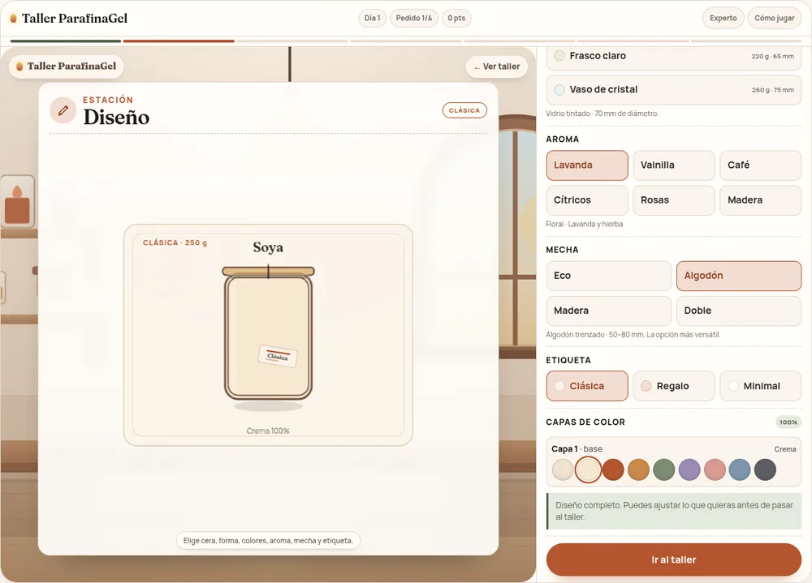
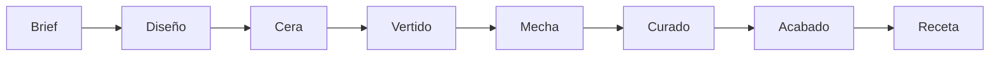
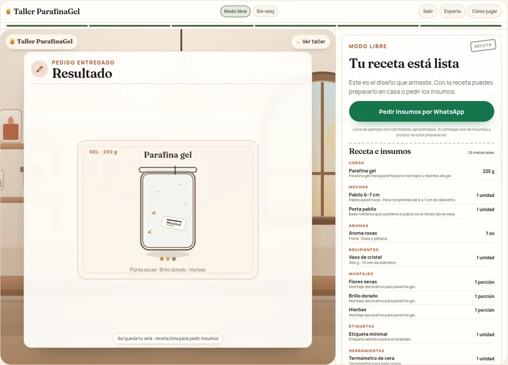

<div align="center">

# 🕯️ ParafinaGel

**Insumos para hacer velas + un taller 2D WebGL que termina en tu receta.**

Ceras, mechas, aromas, colorantes, moldes y kits para tu taller.
El juego enseña el proceso y genera la lista de materiales; no vende velas terminadas.

[](https://astro.build)
[](https://svelte.dev)
[](https://pixijs.com)
[](#el-juego)
[](https://nodejs.org)
[](#qa)

[El juego](#el-juego) · [Empezar](#empezar) · [QA](#qa) · [Estado](#estado) · [Licencia](#licencia)

</div>

<p align="center">
  
</p>

<p align="center"><sub>Captura del prototipo con datos de ejemplo.</sub></p>

## Qué es

ParafinaGel es un negocio familiar de **insumos y materias primas para velas**. Este repositorio reúne el sitio público y un taller interactivo para aprender haciendo: eliges materiales, fabricas una vela paso a paso y recibes una **receta con la lista de insumos**.

El objetivo no es vender una vela terminada. El juego termina en una receta accionable y un CTA de WhatsApp para pedir los materiales.

## El juego

`/juego` es una experiencia cozy ilustrada con escenario **2D WebGL**. El jugador escucha un brief, diseña una vela y la fabrica con retos manuales.



| Estación      | Qué haces                                                                |
| ------------- | ------------------------------------------------------------------------ |
| **Mostrador** | Escuchas al cliente y creas la nota del pedido.                          |
| **Diseño**    | Eliges cera, tamaño, recipiente o molde, capas, aroma, mecha y etiqueta. |
| **Cera**      | Mantienes la palanca para calentar y arrastras la cuchara en círculos.   |
| **Vertido**   | Arrastras la jarra sobre la boca del frasco y cierras cada capa.         |
| **Mecha**     | Colocas la mecha en el centro de la vista superior.                      |
| **Curado**    | Abanicas con el ventilador; en gel, revientas burbujas.                  |
| **Acabado**   | Etiqueta, corte de mecha, tapa y empaque.                                |
| **Receta**    | Recibes puntos, estrellas y la lista de insumos para pedir.              |

- **Cuatro tipos de vela**: clásica, capas, figura con molde y gel con montajes.
- **Simulación de líquido viscoso**: superficie, volumen, película entre capas, salpicaduras, mezcla y burbujas. Afecta el puntaje.
- **Retos manuales**: sin sliders ni botones para las estaciones; el teclado es la alternativa accesible.
- **Modo libre**: diseño sin brief ni reloj, con receta o taller.
- **Modo experto**: oculta las pistas numéricas.
- **Fallback**: si no hay WebGL, muestra el diseño en SVG y permite ver la receta.
- **Motion y accesibilidad**: movimiento reducido, pausa decorativa, foco visible y controles de teclado.

<p align="center">
  
</p>

<p align="center"><sub>El cierre del juego: una receta con cantidades y CTA para pedir los insumos.</sub></p>

## Stack

| Capa       | Tecnología                        |
| ---------- | --------------------------------- |
| Sitio      | Astro 7 con salida 100 % estática |
| Islas      | Svelte 5                          |
| Juego      | PixiJS 8 sobre WebGL 2D           |
| Estilos    | CSS con tokens y modo oscuro      |
| Tests      | Vitest                            |
| QA         | Puppeteer Core + axe-core         |
| Tipografía | Fontsource: Fraunces y Manrope    |

## Empezar

```bash
git clone https://github.com/MiguelCock/ParafinaGel.git
cd ParafinaGel
npm install
npm run dev
```

Abre `http://localhost:4321` para el sitio y `http://localhost:4321/juego` para el taller.

| Comando           | Qué hace                             |
| ----------------- | ------------------------------------ |
| `npm run dev`     | Servidor local de Astro.             |
| `npm run build`   | `check` + build estático en `dist/`. |
| `npm run preview` | Sirve el build.                      |
| `npm test`        | Tests del motor del juego.           |
| `npm run check`   | Diagnóstico de Astro y Svelte.       |
| `npm run qa:game` | QA visual/E2E del juego.             |
| `npm run format`  | Prettier.                            |

## QA

El QA corre contra el build de producción, con un servidor estático local y un navegador real. No forma parte de `npm run build` ni de CI.

```bash
npm run qa:game                  # build + matriz completa (~10 min)
QA_SKIP_BUILD=1 npm run qa:game  # reutiliza dist/
QA_QUICK=1 npm run qa:game       # humo: clásica, sandbox, fallback y checks base
```

Cubre los 4 pedidos, sandbox, fallback sin WebGL, 390/1280, claro/oscuro, puntero y teclado, axe WCAG 2.1 AA, overflow, errores de consola, bundle gzip y FPS de referencia. Los artefactos quedan en `qa/` (ignorada): `qa/report.md`, `qa/report.json` y `qa/screens/`.

<details>
<summary>Variables de QA</summary>

| Variable          | Uso                                                                      |
| ----------------- | ------------------------------------------------------------------------ |
| `BROWSER_PATH`    | Ruta a Brave, Chromium o Chrome. Si falta, se buscan rutas conocidas.    |
| `QA_BASE_URL`     | Usa un servidor ya levantado; no construye ni arranca el servidor local. |
| `QA_SKIP_BUILD=1` | Reutiliza `dist/` para iterar.                                           |
| `QA_QUICK=1`      | Omite los 4 pedidos, móvil, oscuro y la matriz ampliada.                 |
| `QA_OUT_DIR`      | Carpeta de salida de capturas y reportes.                                |
| `QA_PORT`         | Puerto inicial del servidor estático local.                              |
| `QA_HEADLESS=0`   | Abre el navegador para depurar.                                          |
| `QA_VERBOSE=1`    | Log detallado.                                                           |

El FPS se mide en Chromium headless con SwiftShader; sirve como referencia y aviso, no como presupuesto de GPU real.

</details>

## Estructura

```text
src/
  pages/            rutas por archivo
  layouts/          SEO, fuentes, navegación y footer
  components/       UI del sitio
  components/game/  shell, escenario, paneles, brief y fallback
  content/          productos de ejemplo (Markdown)
  lib/game/         motor: diseño, craft, líquido, motion, scoring y receta
  lib/game/render/  escenas PixiJS, candle rig, paleta y motion
  styles/           tokens y estilos globales
scripts/qa/         harness de QA
docs/               capturas usadas en este README
```

Rutas: `/`, `/productos`, `/productos/[slug]`, `/nosotros`, `/juego`, `/contacto` y 404. `/about` redirige a `/nosotros`.

## Estado

El prototipo está funcional y verificado, pero todavía usa **datos de ejemplo**. El catálogo real de insumos, los precios y los datos técnicos están pendientes de validación con el negocio.

> [!WARNING]
> Repositorio público con datos de ejemplo. No hay demo pública ni dominio real todavía. El contacto, el catálogo, los precios, las temperaturas y las cantidades son placeholders.

| Pendiente                            | Dónde                              |
| ------------------------------------ | ---------------------------------- |
| Dominio real                         | `astro.config.mjs`                 |
| WhatsApp, correo, Instagram y ciudad | `src/config/site.ts`               |
| Catálogo de insumos y precios        | `src/content/productos/*.md`       |
| Briefs y datos técnicos              | `src/lib/game/data.ts`             |
| Revisión final del copy              | `src/pages/*` y `src/components/*` |

Historias relacionadas: [catálogo de insumos](https://github.com/MiguelCock/ParafinaGel/issues/90) · [datos técnicos](https://github.com/MiguelCock/ParafinaGel/issues/87) · [game juice](https://github.com/MiguelCock/ParafinaGel/issues/107) · [baseline visual](https://github.com/MiguelCock/ParafinaGel/issues/108).

## Licencia

Este repositorio es público como muestra del proyecto, pero **no es open source**.

El código, el arte y la marca son de ParafinaGel. Puedes leer y estudiar el repositorio como referencia personal; no puedes forkearlo, redistribuirlo ni reutilizarlo en otro proyecto. GitHub no permite desactivar forks en repositorios públicos de cuentas personales, así que la licencia es la que establece la restricción; si necesitas bloquearlo también a nivel técnico, el repositorio tendría que ser privado. Para permisos especiales, abre un issue.

Ver [`LICENSE`](LICENSE).

## Antes de publicar

- [ ] Reemplazar dominio, WhatsApp, correo, Instagram y ciudad.
- [ ] Migrar el catálogo de ejemplo a insumos y materias primas.
- [ ] Cargar precios reales y quitar `borrador: true`.
- [ ] Validar briefs, temperaturas, tiempos, mechas y cantidades con el negocio.
- [ ] Revisar el copy completo del sitio.
- [ ] Reemplazar retratos y escenas placeholder por arte final si se desea.
- [ ] Agregar fotos reales con `alt` descriptivos.
- [ ] Ejecutar `npm run format:check`, `npm test`, `npm run check`, `npm run build` y `npm run qa:game`.
- [ ] Revisar 360 px, 768 px y desktop; WebGL y fallback.
